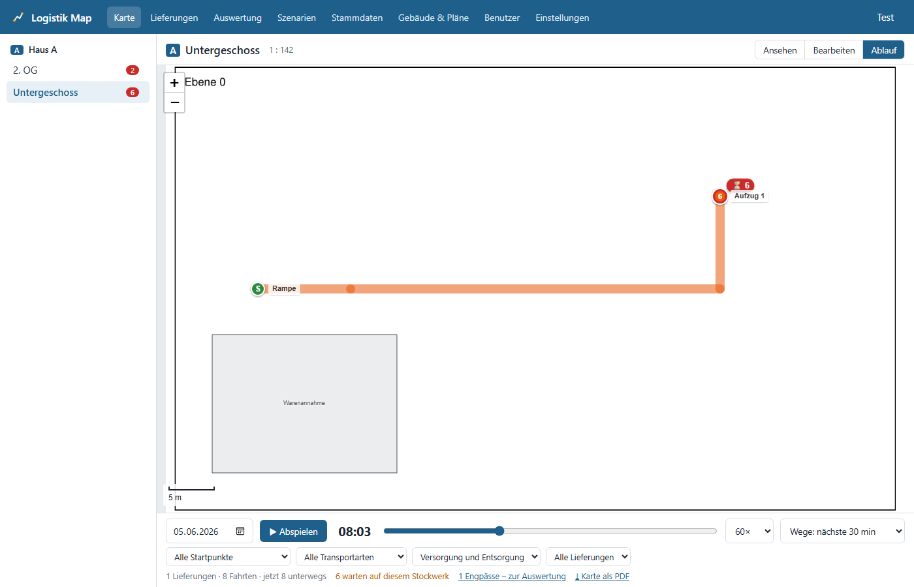
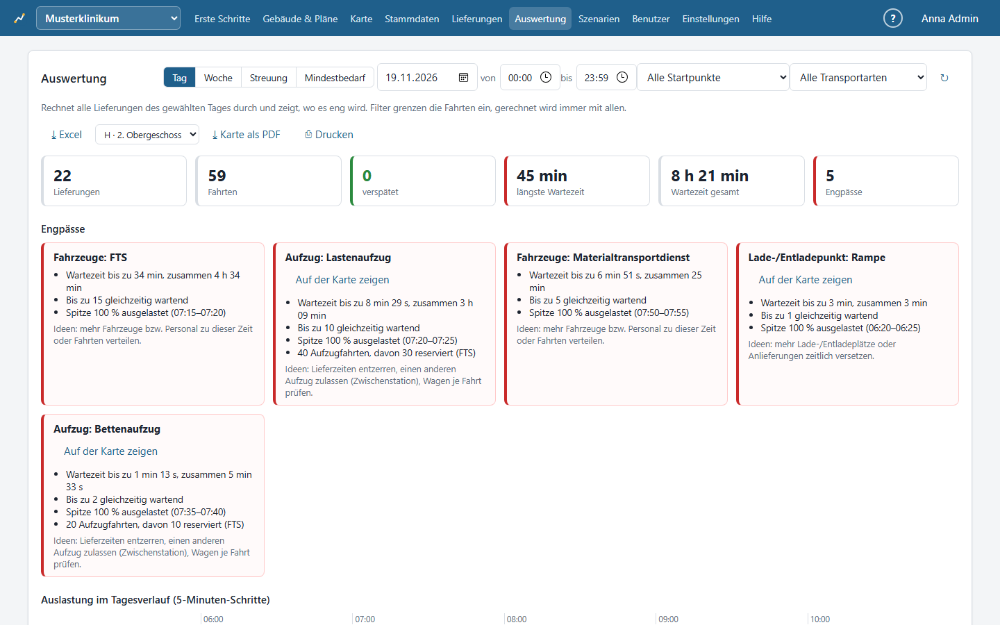

# Logistik Map

*[English version](README.md)*

Logistik Map zeigt Warenflüsse und Transportwege in großen Gebäuden, zum Beispiel im
Krankenhaus. Grundlage sind die Gebäudepläne als PDF: Stockwerke anlegen, Pläne hochladen,
Wege und Lieferungen einzeichnen und sehen, wo es eng wird.

## So arbeitest du damit

Nach der Installation öffnet sich die Seite **Erste Schritte**. Sie führt durch die Einrichtung,
prüft selbst, was erledigt ist, und springt mit „Beheben“ an die Stelle, an der etwas fehlt –
zum Beispiel zu einem Punkt, der an keinem Weg hängt, oder zu einer Lieferung, für die es keinen
Weg gibt. Die Reihenfolge:

1. **Gebäude & Pläne**: Gebäudeteile und Stockwerke anlegen, PDF hochladen, Seite zuweisen.
2. **Karte → Bearbeiten**: Maßstab eintragen (z. B. 1:200, steht er als Text im Plan, wird er
   vorgeschlagen), Flure als Wege zeichnen, Start- und Zielpunkte setzen (Lager, Stationen,
   Aufbereitung), LKW-Tore an der Rampe mit ihrer Anzahl, Aufzüge auf jedem Stockwerk als Punkt.
   Bei Bedarf Bereiche und Räume einzeichnen.
3. **Stammdaten**: Transportarten (z. B. FTS, Materialtransportdienst), Wagentypen und die
   Zeiten der Aufzüge an euer Haus anpassen.
4. **Lieferungen**: in einer Zeile „Um 08:00 kommen 5 Paletten vom Tor nach B25“. Weg, Aufzug
   und Transportart sucht das System selbst. Interne Transporte genauso, z. B. Bettentausch
   Station → Aufbereitung, beladen zurück. Wochentage, Feiertagsregel und Rückweg lassen sich
   danach anpassen.
5. **Karte → Ablauf** und **Auswertung**: Tag und Uhrzeit wählen und sehen, wohin die Ware
   geht, wo gewartet wird und welcher Aufzug zum Engpass wird.

6. **Szenarien**: „Was wäre, wenn die Wäsche um 7:30 käme?“ oder „… wenn Aufzug West in
   Wartung ist?“ Das Szenario lässt sich mit dem Ist-Zustand vergleichen und auf Wunsch übernehmen.

Wie gerechnet wird, steht in [KONZEPT.md](KONZEPT.md).




## Lieferungen aus Excel übernehmen

Unter **Lieferungen → Excel** lädst du die aktuelle Liste herunter. Diese Datei ist zugleich die
Vorlage, das Blatt „Hinweise“ erklärt alle Spalten und Schreibweisen. Zeilen mit ID ändern
vorhandene Lieferungen, Zeilen ohne ID legen neue an. Beim Import wird jede Zeile geprüft.
Übernommen wird erst, wenn alle Zeilen in Ordnung sind. CSV (Semikolon oder Komma) geht auch.

## Installation (Windows-Server)

1. `LogistikMap-Setup-x.y.z.exe` aus den Releases herunterladen und als Administrator ausführen.
2. Port wählen (Standard 8470) und bei Bedarf die Firewall-Freigabe anhaken.
3. Nach der Installation öffnet sich der Browser. Dort legst du das Administrator-Konto an.

Logistik Map läuft dann als Windows-Dienst **LogistikMap** und ist im Netzwerk unter
`http://<Servername>:<Port>` erreichbar.

Die Daten liegen in `C:\ProgramData\Logistik Map` (Datenbank, PDF-Pläne, Kacheln, Protokolle,
`config.json`). Update und Deinstallation lassen sie unangetastet.

### Sicherung

Logistik Map sichert automatisch nach `C:\ProgramData\Logistik Map\sicherungen`: täglich die
Datenbank, einmal pro Woche zusätzlich alle PDF-Pläne. Unter **Einstellungen → Sicherung**
kannst du eine vollständige Sicherung herunterladen oder eine Sicherung einspielen. Für die
Datensicherung des Servers reicht es, diesen Ordner mitzusichern.

### Anmeldung, Sitzungen und Protokoll

- Nach 5 falschen Passwörtern wird ein Benutzername für eine Minute gesperrt. Eine Adresse wird
  erst nach 30 Fehlversuchen gesperrt, damit Terminalserver und Citrix nicht alle aussperren.
- Abgemeldet wird nach 12 Stunden ohne Nutzung. Benutzer aus dem Active Directory müssen sich
  spätestens nach 12 Stunden neu anmelden, ein dort gesperrtes Konto verliert den Zugang also
  innerhalb einer Schicht. Beides lässt sich unter **Einstellungen** ändern.
- Das Änderungsprotokoll (wer hat wann was geändert) wird standardmäßig 365 Tage aufbewahrt.
  Die Frist ist einstellbar, zum Beispiel nach Absprache mit dem Personalrat.

### Updates

Unter **Einstellungen → Updates** prüft Logistik Map, ob es eine neue Version gibt, und
installiert sie auf Knopfdruck. Dafür braucht der Server Zugriff auf github.com. Sonst einfach das
neue Setup herunterladen und ausführen. Daten und Einstellungen bleiben erhalten.

### HTTPS

Ein Zertifikat mit privatem Schlüssel im PEM-Format, etwa von der eigenen IT, unter
**Einstellungen → HTTPS** eintragen und neu starten. Aus einer PFX-Datei werden die beiden
Dateien zum Beispiel so erzeugt:

```
openssl pkcs12 -in logistik.pfx -clcerts -nokeys -out logistik.pem
openssl pkcs12 -in logistik.pfx -nocerts -nodes -out logistik-key.pem
```

### Anmeldung über Active Directory

Unter **Einstellungen → Anmeldung über Active Directory** Server (am besten `ldaps://…`),
Domäne und Suchbasis eintragen und AD-Gruppen den Rollen zuordnen. Mit „Testen“ lässt sich ein
Konto vorab prüfen. Lokale Benutzer wie der Administrator funktionieren weiter.

### Pläne vorab prüfen

```
"C:\Program Files\Logistik Map\LogistikMap.exe" plan-test "D:\Pläne\Haus A UG.pdf"
```

Das zeigt Größe, Zoomstufen und die geschätzte Aufbereitungszeit je Seite.

### Admin-Passwort vergessen

In einer Eingabeaufforderung mit Administratorrechten:

```
"C:\Program Files\Logistik Map\LogistikMap.exe" passwort admin
```

## Entwicklung

```
python -m venv .venv
.venv\Scripts\pip install -r requirements-dev.txt
.venv\Scripts\python -m pytest
.venv\Scripts\python -m logistikmap --data data serve --port 8470
```

Oberflächentests im Browser (Playwright, lokal mit Edge):

```
.venv\Scripts\pip install -r requirements-e2e.txt
set E2E=1
.venv\Scripts\python -m pytest tests/e2e
```

Das Setup baut `installer\build.ps1`. Dafür werden Inno Setup 6 und `gh` gebraucht.
Ein Tag `vX.Y.Z` baut über GitHub Actions das Setup und veröffentlicht es als Release.

### Aufbau

| Pfad | Inhalt |
|---|---|
| `logistikmap/server.py` | Webserver und JSON-Schnittstelle |
| `logistikmap/db.py` | SQLite-Datenbank mit Migrationen |
| `logistikmap/plaene.py` | PDF → Kartenkacheln (PyMuPDF) |
| `logistikmap/feiertage.py` | Feiertage je Bundesland |
| `logistikmap/regeln.py` | Wiederholungsregeln der Lieferungen |
| `logistikmap/netz.py` | Wegenetz und Wegsuche |
| `logistikmap/simulation.py` | Ablauf eines Tages mit Wartezeiten |
| `logistikmap/planung.py` | Schnittstellen für Netz, Stammdaten, Lieferungen, Szenarien, Simulation |
| `logistikmap/einrichtung.py` | Prüfung für die Seite „Erste Schritte“ |
| `logistikmap/export.py` | Excel-Import/-Export, Karte als PDF |
| `logistikmap/wartung.py` | Sicherung, Wiederherstellung, Updates |
| `logistikmap/verzeichnis.py` | Anmeldung über Active Directory (LDAP) |
| `logistikmap/protokoll.py` | Änderungsprotokoll |
| `logistikmap/static/` | Oberfläche (ohne Build-Schritt, Leaflet liegt bei) |
| `logistikmap/static/i18n/` | Texte der Oberfläche je Sprache |
| `installer/` | Inno-Setup-Skript, Windows-Dienst (WinSW), Build-Skript |

### Weitere Sprache hinzufügen

Deutsch und Englisch sind enthalten. Für eine weitere Sprache:

1. `logistikmap/static/i18n/de.json` kopieren, z. B. nach `fr.json`, und übersetzen.
2. In `logistikmap/server.py` die Sprache in `SPRACHEN` eintragen.

`tests/test_oberflaeche.py` prüft, ob alle Schlüssel und Platzhalter vorhanden sind.

## Lizenz

[GNU Affero General Public License v3.0](LICENSE). Die Lizenzen aller mitgelieferten
Bestandteile (u. a. PyMuPDF unter AGPL-3.0, ldap3 unter LGPL-3.0, Leaflet, WinSW) stehen nach
der Installation in `THIRD_PARTY_LICENSES.txt` im Programmordner. Erzeugt wird die Datei beim
Bauen mit `installer/lizenzen.py`.
