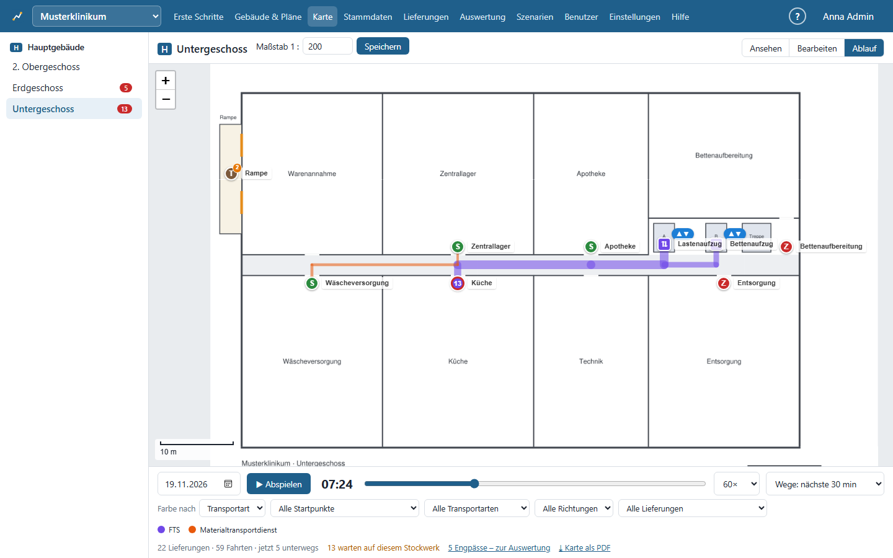
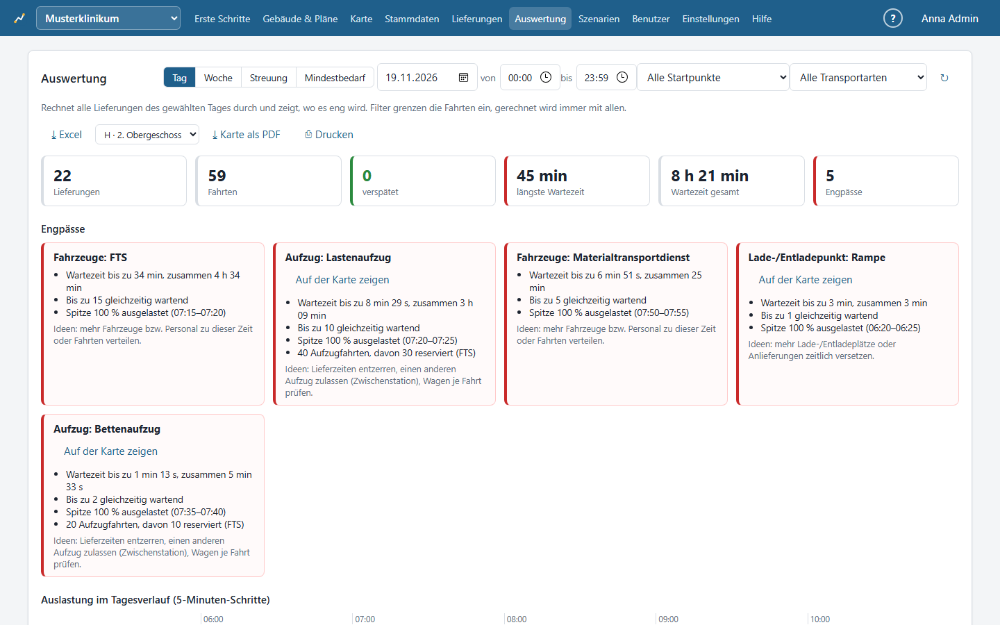
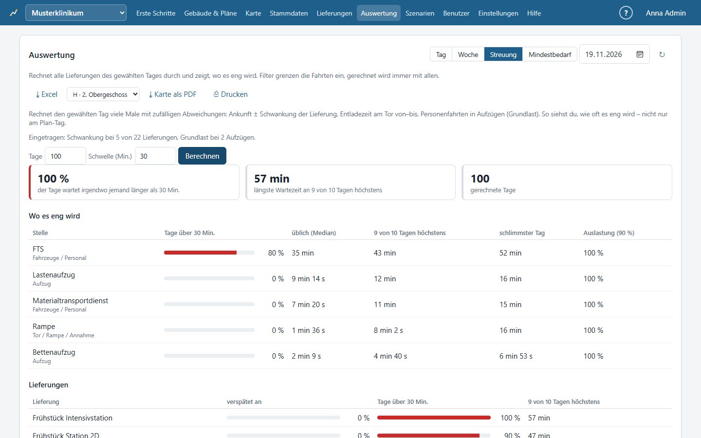
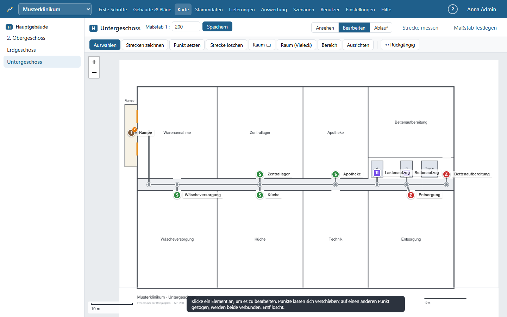
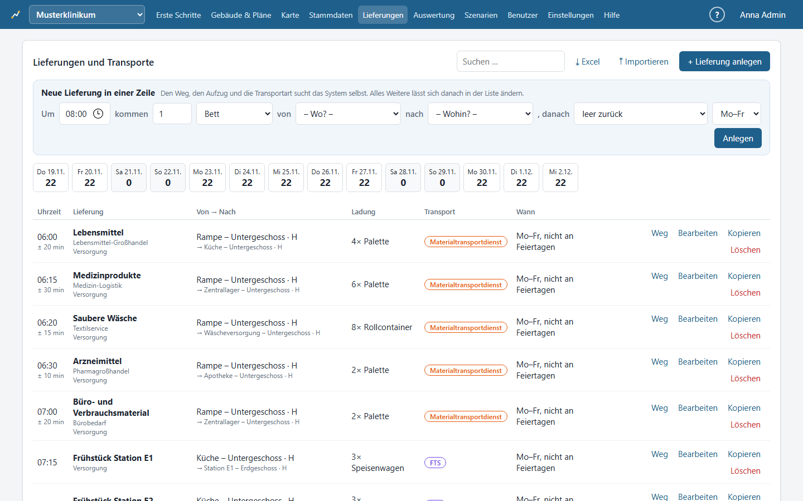
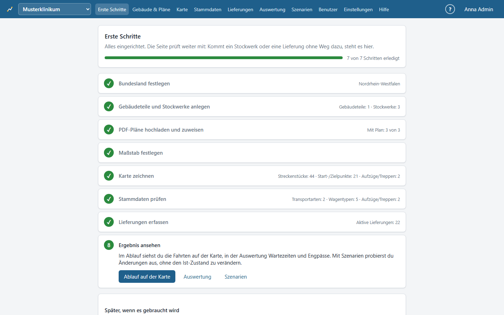
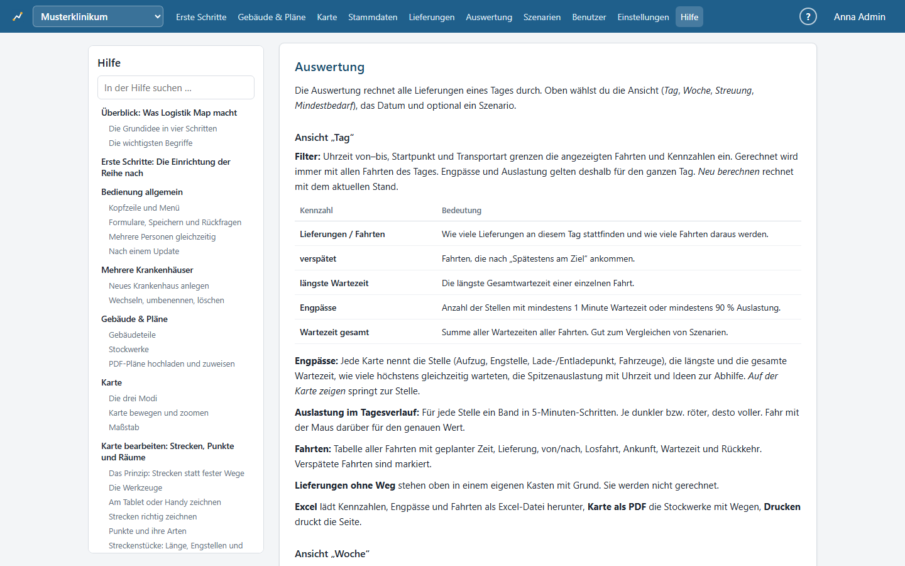
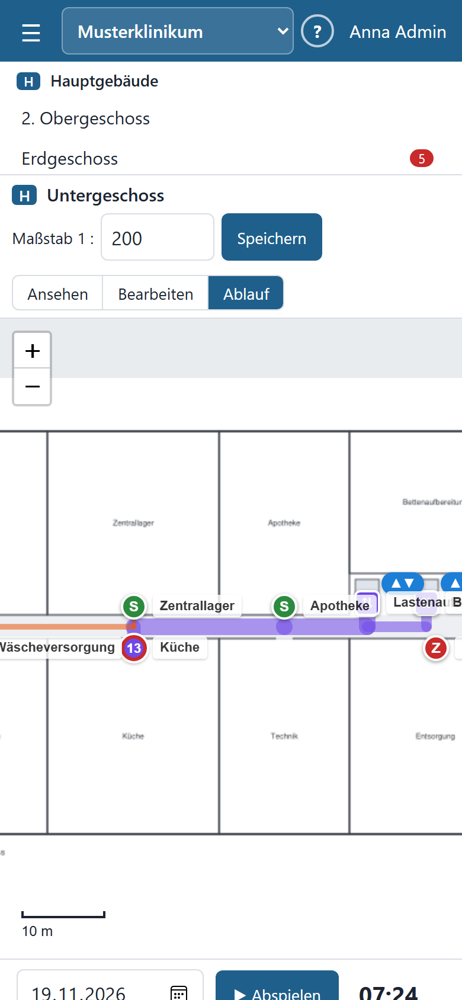
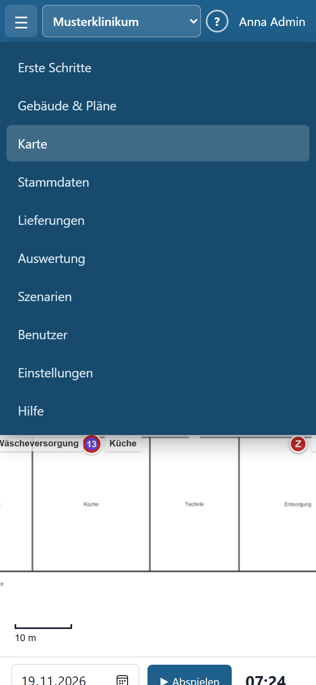

<div align="center">


# Logistik Map

**See how goods move through your hospital –<br>from the loading dock via the lift to the ward.**

[](https://github.com/phillhf/logistik-map/releases/latest)
[](https://github.com/phillhf/logistik-map/actions/workflows/tests.yml)
[](LICENSE)


[**⬇ Download**](https://github.com/phillhf/logistik-map/releases/latest) ·
[**For IT departments**](#for-it-departments) ·
[Features](#features) ·
[Installation](#installation) ·
[Deutsch](README.md)

</div>



## What it is for

Every morning linen, meals, medicines and pallets arrive and have to reach the wards – through the
same corridors and the same lifts. Logistik Map simulates such a day on top of the real floor
plans and answers questions like:

- **Can the lifts handle breakfast at 7:15?** Who is waiting where, and when?
- **How many automated vehicles, gates or staff do we need at least** so nobody waits longer than
  15 minutes?
- **What if** the linen arrived at 7:30, or the west lift were out of service?
- **How often does it get tight** when trucks arrive a bit earlier or later?

Floor plans are uploaded as PDF (including large CAD exports), the routes are drawn once on top,
and each delivery is entered in a single line. Route, lift and vehicle are chosen by the system.

## Features

<table>
<tr>
<td width="50%" valign="top">

**Plan**
- **Floor plans from PDF** – even A0 CAD exports, converted once into a zoomable map. Type in
  the scale (suggested from the plan text) or measure it.
- **Draw routes** instead of every single path: junctions are created automatically, gaps are
  found by the check. On a PC, tablet or phone.
- **Deliveries in one line:** “At 08:00, 5 pallets from the gate to B25” – with weekdays,
  holiday rule, return trip and Excel import.
- **Master data:** vehicles and staff with shifts, trolley types, lifts with travel, door and
  clearing times and passenger load.

</td>
<td width="50%" valign="top">

**Calculate and analyse**
- **Timeline on the map**, coloured by transport type, delivery or direction.
- **Bottlenecks** with waiting time, peak utilisation and ideas to fix them; day profile and
  weekly heat map.
- **Variation:** calculate the day a hundred times with random deviations – “on how many days
  does it get tight?”
- **Minimum needed:** smallest number of gates, vehicles or staff for a target.
- **Scenarios** compared with the current state, export to Excel and PDF.

</td>
</tr>
<tr>
<td valign="top">

**Guided**
- **Getting started** walks through the setup, checks by itself what is missing and jumps to the
  right place with “Fix”.
- **Detailed built-in help** for every page and parameter, with search and step-by-step guides.
- User interface in **English and German**, public holidays of all German federal states.

</td>
<td valign="top">

**Operations**
- **Windows installer** with service, runs entirely inside your own network.
- **Active Directory**, roles and permissions, **access per hospital**, audit log.
- **Several hospitals** in one installation.
- Daily **backups**, **HTTPS**, one-click **updates** with checksum verification.

</td>
</tr>
</table>

## Screenshots

<table>
<tr>
<td width="50%"><br><sub><b>Analysis</b> – key figures, bottlenecks with ideas, utilisation over the day</sub></td>
<td width="50%"><br><sub><b>Variation</b> – 100 random days: where and how often does it get tight?</sub></td>
</tr>
<tr>
<td><br><sub><b>Map editor</b> – routes, gates, lifts and destinations on the PDF plan</sub></td>
<td><br><sub><b>Deliveries</b> – created in one line, preview of the coming days</sub></td>
</tr>
<tr>
<td><br><sub><b>Getting started</b> – guided setup that checks along</sub></td>
<td><br><sub><b>Help</b> – every page and parameter explained, with search</sub></td>
</tr>
</table>

<p align="center">

&nbsp;&nbsp;

<br><sub>Works on tablets and phones too</sub>
</p>

<sub>The screenshots show the German user interface and the fictional “Musterklinikum”. Plan,
rooms and suppliers are made up and generated by [`werkzeuge/screenshots.py`](werkzeuge/screenshots.py).</sub>

## For IT departments

A detailed description for approval and operations (in German) is in **[docs/IT.md](docs/IT.md)**.
In short:

| | |
|---|---|
| **Type** | Web application: one Windows service on a server, accessed with a browser inside your network |
| **System** | Windows Server 2016 or later, Windows 10/11, 64-bit; no additional runtimes required |
| **Network** | one TCP port (default 8470), HTTP or HTTPS with your own certificate |
| **Outbound connections** | none required. Only the update check contacts github.com; without it everything keeps working |
| **Data** | stored locally in `C:\ProgramData\Logistik Map` (SQLite, PDF plans, backups). No patient data, no telemetry |
| **Sign-in** | local accounts (scrypt) and/or Active Directory via LDAP(S), roles and permissions, lockout after failed attempts |
| **Accountability** | audit log with configurable retention |
| **Source** | fully open (AGPL-3.0); the installer is built by GitHub Actions from this repository and ships with a SHA-256 checksum |

## Installation

1. Download [`LogistikMap-Setup-x.y.z.exe`](https://github.com/phillhf/logistik-map/releases/latest)
   and run it as administrator.
2. Choose the port (default 8470) and optionally open it in the Windows firewall.
3. The browser opens afterwards – create the administrator account there. The **Getting started**
   page then guides you through the setup.

Logistik Map runs as the Windows service **LogistikMap** and is available at
`http://<server>:<port>`. Unattended, e.g. for software deployment:

```
LogistikMap-Setup-x.y.z.exe /VERYSILENT /PORT=8470 /TASKS="firewall"
```

Data lives in `C:\ProgramData\Logistik Map` and is kept on updates and uninstallation.

## Operations

- **Backups** are written automatically to `C:\ProgramData\Logistik Map\sicherungen`: the database
  daily, all PDF plans once a week. *Settings → Backup* downloads or restores a full backup.
- **Sign-in:** a user name is locked for one minute after 5 wrong passwords (an address only after
  30, so terminal servers are not locked out). Sessions end after 12 hours of inactivity; Active
  Directory users sign in again after at most 12 hours. Both are configurable.
- **Audit log:** who changed what and when, kept for 365 days by default (configurable).
- **Updates:** *Settings → Updates* checks for a new release and installs it with one click after
  verifying the checksum. This needs access to github.com; otherwise just run the new setup.
- **HTTPS:** enter a certificate and private key (PEM) under *Settings → HTTPS* and restart.
- **Active Directory:** server (preferably `ldaps://…`), domain and search base under *Settings →
  Sign-in via Active Directory*; map AD groups to roles and test an account beforehand.
- **Forgotten admin password:** `"C:\Program Files\Logistik Map\LogistikMap.exe" passwort admin`
  in an elevated command prompt.

How the simulation works is described in [KONZEPT.md](KONZEPT.md) (German).

## Development

```
python -m venv .venv
.venv\Scripts\pip install -r requirements-dev.txt
.venv\Scripts\python -m pytest
.venv\Scripts\python -m logistikmap --data data serve --port 8470
```

Browser tests (Playwright, locally with Edge):

```
.venv\Scripts\pip install -r requirements-e2e.txt
set E2E=1
.venv\Scripts\python -m pytest tests/e2e
```

`.venv\Scripts\python werkzeuge\screenshots.py` regenerates the screenshots. `installer\build.ps1`
builds the setup (requires Inno Setup 6 and `gh`); a tag `vX.Y.Z` builds and publishes a release
via GitHub Actions. The project structure is described in the [German README](README.md#aufbau).

### Adding a language

1. Copy `logistikmap/static/i18n/de.json`, e.g. to `fr.json`, and translate it.
2. Add the language to `SPRACHEN` in `logistikmap/server.py`.

`tests/test_oberflaeche.py` checks that all keys and placeholders are present.

## Security

Please do not report vulnerabilities in public issues – see [SECURITY.md](SECURITY.md).

## License

[GNU Affero General Public License v3.0](LICENSE). Free to use, including in hospital operations.
The licenses of all bundled components (including PyMuPDF under AGPL-3.0, ldap3 under LGPL-3.0,
Leaflet, WinSW) are installed as `THIRD_PARTY_LICENSES.txt` in the program folder; the file is
generated by `installer/lizenzen.py` during the build.
