<div align="center">


# Logistik Map

**Warenflüsse und Transportwege im Krankenhaus sichtbar machen –<br>von der Rampe über den Aufzug bis auf die Station.**

[](https://github.com/phillhf/logistik-map/releases/latest)
[](https://github.com/phillhf/logistik-map/actions/workflows/tests.yml)
[](LICENSE)


[**⬇ Herunterladen**](https://github.com/phillhf/logistik-map/releases/latest) ·
[Technik](#technik-im-überblick) ·
[Funktionen](#funktionen) ·
[Installation](#installation) ·
[English](README.en.md)

</div>

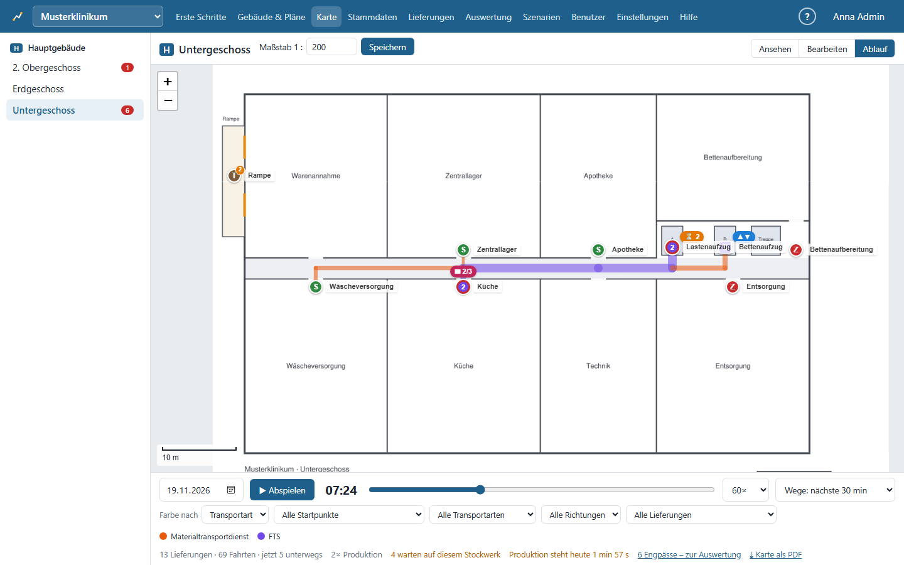

## Worum es geht

Jeden Morgen kommen Wäsche, Speisen, Medikamente und Paletten ins Haus und müssen auf die
Stationen – über dieselben Flure und dieselben Aufzüge. Logistik Map rechnet einen solchen Tag
auf Basis der echten Gebäudepläne durch und beantwortet Fragen wie:

- **Schaffen die Aufzüge das Frühstück um 7:15?** Wer steht wann wo und wartet?
- **Wie viele FTS, Tore oder Mitarbeitende brauchen wir mindestens**, damit niemand länger als
  15 Minuten wartet?
- **Was wäre, wenn** die Wäsche erst um 7:30 käme oder Aufzug West in Wartung ist?
- **Wie oft wird es eng**, wenn LKW mal früher, mal später kommen?

Die Pläne kommen als PDF (auch große CAD-Exporte), die Strecken zeichnet man einmal darüber, die
Lieferungen trägt man in einer Zeile ein. Den Weg, den Aufzug und das Fahrzeug sucht das System
selbst.

## Funktionen

<table>
<tr>
<td width="50%" valign="top">

**Planen**
- **Pläne aus PDF** – auch A0-CAD-Exporte, einmal in eine zoombare Karte umgewandelt.
  Maßstab eintippen (wird aus dem Plantext vorgeschlagen) oder abmessen.
- **Strecken zeichnen** statt jeden Weg einzeln: Kreuzungen entstehen von selbst,
  Lücken findet die Prüfung. Am PC, Tablet oder Handy.
- **Lieferungen in einer Zeile:** „Um 08:00 kommen 5 Paletten vom Tor nach B25“ –
  mit Wochentagen, Feiertagsregel, Rückweg und Excel-Import.
- **Produktion:** Küche, Sterilgut oder Wäscherei machen im Takt Wagen fertig, die abgeholt
  werden – mit Stellplätzen und Rückstau, wenn niemand kommt.
- **Stammdaten:** Fahrzeuge und Personal mit Schichten, Wagentypen, Aufzüge mit
  Fahr-, Tür- und Räumzeiten und Personen-Grundlast.

</td>
<td width="50%" valign="top">

**Rechnen und Auswerten**
- **Ablauf auf der Karte** im Zeitraffer, eingefärbt nach Transportart, Lieferung
  oder Richtung.
- **Engpässe** mit Wartezeit, Spitzenauslastung und Ideen zur Abhilfe;
  Tagesverlauf und Wochen-Heatmap.
- **Streuung:** den Tag hundertfach mit zufälligen Abweichungen rechnen –
  „an wie vielen Tagen wird es eng?“
- **Mindestbedarf:** kleinste Zahl an Toren, Fahrzeugen oder Personal für ein Ziel.
- **Szenarien** im Vergleich zum Ist-Zustand, Export nach Excel und PDF.

</td>
</tr>
<tr>
<td valign="top">

**Geführt**
- **Erste Schritte** führt durch die Einrichtung, prüft selbst, was fehlt, und springt
  mit „Beheben“ an die richtige Stelle.
- **Ausführliche Hilfe im Programm** zu jeder Seite und jedem Parameter, mit Suche
  und Schritt-für-Schritt-Anleitungen.
- Oberfläche auf **Deutsch und Englisch**, Feiertage aller Bundesländer.

</td>
<td valign="top">

**Betrieb**
- **Windows-Installer** mit Dienst, läuft komplett im eigenen Netz.
- **Active Directory**, Rollen und Rechte, **Zugriff je Krankenhaus**,
  Änderungsprotokoll.
- **Mehrere Krankenhäuser** in einer Installation.
- Tägliche **Sicherung**, **HTTPS**, **Updates** auf Knopfdruck mit Prüfsumme.

</td>
</tr>
</table>

## So sieht es aus

<table>
<tr>
<td width="50%">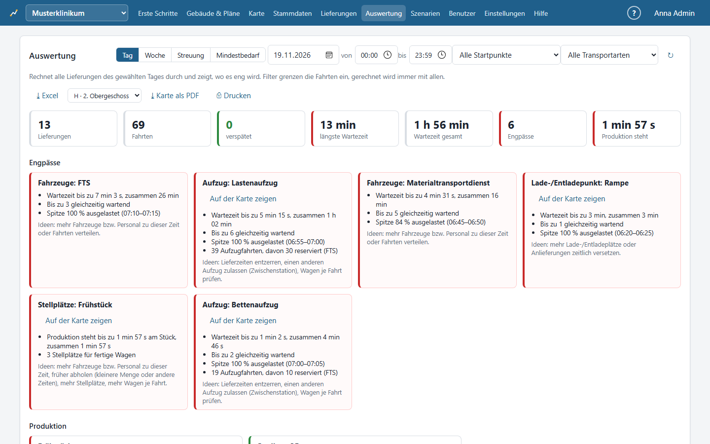<br><sub><b>Auswertung</b> – Kennzahlen, Engpässe mit Ideen zur Abhilfe, Auslastung im Tagesverlauf</sub></td>
<td width="50%">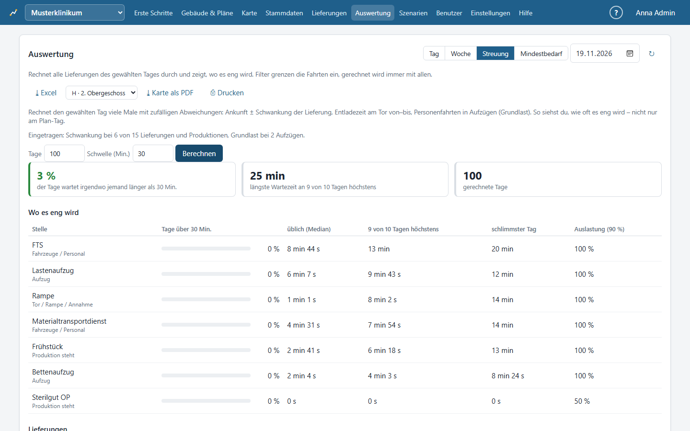<br><sub><b>Streuung</b> – 100 zufällige Tage: Wo wird es wie oft eng?</sub></td>
</tr>
<tr>
<td>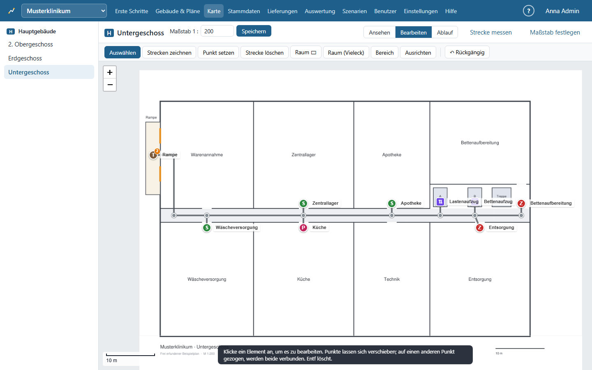<br><sub><b>Karte bearbeiten</b> – Strecken, Tore, Aufzüge und Ziele auf dem PDF-Plan</sub></td>
<td>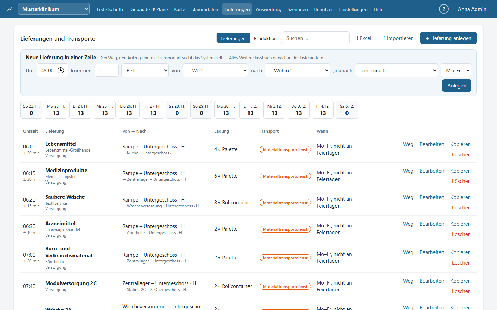<br><sub><b>Lieferungen</b> – in einer Zeile anlegen, Vorschau der nächsten Tage</sub></td>
</tr>
<tr>
<td>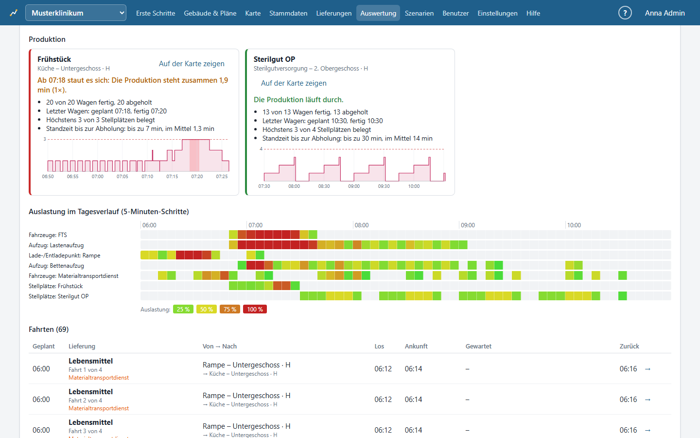<br><sub><b>Produktion</b> – wann sich fertige Wagen stauen und die Küche steht</sub></td>
<td><br><sub><b>Ablauf</b> – der Tag auf der Karte, mit wartenden Wagen an der Küche</sub></td>
</tr>
<tr>
<td>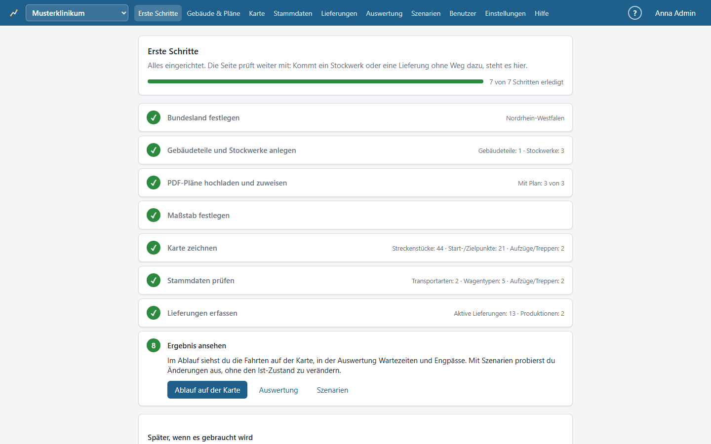<br><sub><b>Erste Schritte</b> – geführte Einrichtung, die selbst mitprüft</sub></td>
<td>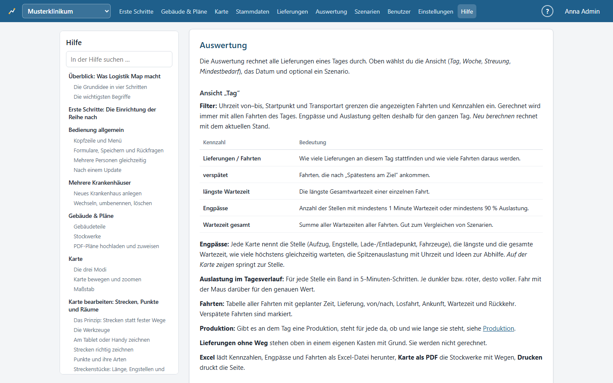<br><sub><b>Hilfe</b> – jede Seite und jeder Parameter erklärt, mit Suche</sub></td>
</tr>
</table>

<p align="center">
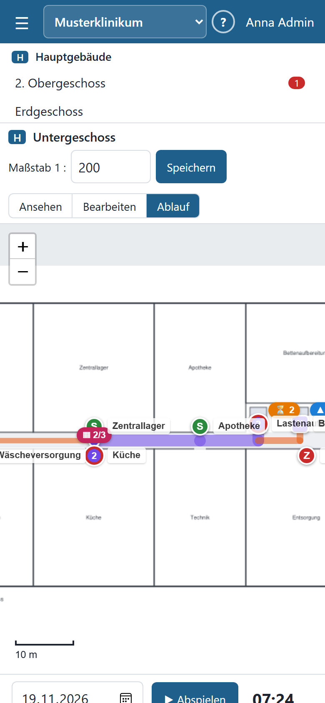
&nbsp;&nbsp;
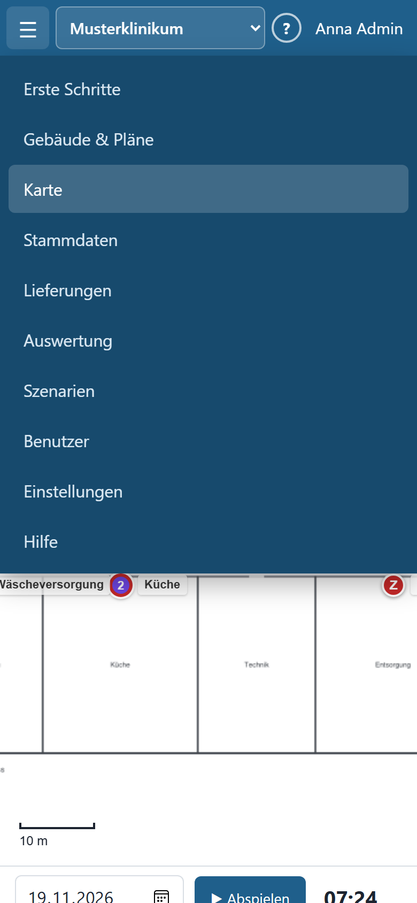
<br><sub>Auch auf Tablet und Handy bedienbar</sub>
</p>

<sub>Alle Bilder zeigen das frei erfundene „Musterklinikum“. Plan, Räume und Lieferanten sind
ausgedacht und werden mit [`werkzeuge/screenshots.py`](werkzeuge/screenshots.py) erzeugt.</sub>

## Technik im Überblick

Weiterführende Informationen zu Aufbau, Netzwerk, Daten und Betrieb stehen in
**[docs/TECHNIK.md](docs/TECHNIK.md)**. Kurz:

| | |
|---|---|
| **Art** | Webanwendung: ein Windows-Dienst auf einem Server, Zugriff per Browser im eigenen Netz |
| **System** | Windows Server 2016 oder neuer bzw. Windows 10/11, 64 Bit; keine weiteren Laufzeitumgebungen nötig |
| **Netzwerk** | ein TCP-Port (Standard 8470), HTTP oder HTTPS mit eigenem Zertifikat |
| **Verbindungen nach außen** | keine Pflicht. Nur die Update-Prüfung fragt bei github.com nach, ohne Verbindung läuft alles weiter |
| **Daten** | lokal in `C:\ProgramData\Logistik Map` (SQLite, PDF-Pläne, Sicherungen). Keine Patientendaten, keine Telemetrie |
| **Anmeldung** | lokale Konten (scrypt) und/oder Active Directory per LDAP(S), Rollen und Rechte, Sperre bei Fehlversuchen |
| **Nachvollziehbarkeit** | Änderungsprotokoll mit einstellbarer Aufbewahrungsfrist |
| **Quellcode** | vollständig offen (AGPL-3.0), Installer per GitHub Actions aus diesem Repository gebaut, mit SHA-256-Prüfsumme |

## Installation

1. [`LogistikMap-Setup-x.y.z.exe`](https://github.com/phillhf/logistik-map/releases/latest) herunterladen
   und als Administrator ausführen.
2. Port wählen (Standard 8470) und bei Bedarf die Firewall-Freigabe anhaken.
3. Nach der Installation öffnet sich der Browser. Dort legst du das Administrator-Konto an –
   danach führt die Seite **Erste Schritte** durch die Einrichtung.

Logistik Map läuft dann als Windows-Dienst **LogistikMap** und ist im Netzwerk unter
`http://<Servername>:<Port>` erreichbar. Unbeaufsichtigt, z. B. für die Softwareverteilung:

```
LogistikMap-Setup-x.y.z.exe /VERYSILENT /PORT=8470 /TASKS="firewall"
```

Die Daten liegen in `C:\ProgramData\Logistik Map` (Datenbank, PDF-Pläne, Kacheln, Protokolle,
`config.json`). Update und Deinstallation lassen sie unangetastet.

## So arbeitest du damit

Eine ausführliche Anleitung steckt im Programm: Menüpunkt **Hilfe** oder **?** oben rechts, das
die Hilfe zur gerade offenen Seite öffnet. Die Reihenfolge der Einrichtung:

1. **Gebäude & Pläne**: Gebäudeteile und Stockwerke anlegen, PDF hochladen, Seite zuweisen.
2. **Karte → Bearbeiten**: Maßstab eintragen, alle befahrbaren Strecken zeichnen, Start- und
   Zielpunkte setzen (Lager, Stationen, Aufbereitung), LKW-Tore mit ihrer Anzahl, Aufzüge auf
   jedem Stockwerk.
3. **Stammdaten**: Transportarten (z. B. FTS, Materialtransportdienst), Wagentypen und die Zeiten
   der Aufzüge an euer Haus anpassen.
4. **Lieferungen**: in einer Zeile eintragen, Wochentage, Feiertagsregel und Rückweg danach
   anpassen – oder aus Excel übernehmen.
5. **Karte → Ablauf** und **Auswertung**: sehen, wohin die Ware geht, wo gewartet wird und welcher
   Aufzug zum Engpass wird.
6. **Streuung, Mindestbedarf, Szenarien**: wie oft es eng wird, wie viele reichen, und was eine
   Änderung bringen würde.

**Mehrere Krankenhäuser:** Oben neben „Logistik Map“ wählst du das Krankenhaus, über
„＋ Neues Krankenhaus …“ legst du ein weiteres an. Jedes hat eigene Gebäude, Pläne, Strecken,
Stammdaten, Lieferungen und Auswertungen. Unter **Benutzer** lässt sich je Person festlegen,
welche Häuser sie sehen darf.

Wie gerechnet wird, steht in [KONZEPT.md](KONZEPT.md).

### Lieferungen aus Excel übernehmen

Unter **Lieferungen → Excel** lädst du die aktuelle Liste herunter. Diese Datei ist zugleich die
Vorlage, das Blatt „Hinweise“ erklärt alle Spalten und Schreibweisen. Zeilen mit ID ändern
vorhandene Lieferungen, Zeilen ohne ID legen neue an. Beim Import wird jede Zeile geprüft;
übernommen wird erst, wenn alle Zeilen in Ordnung sind. CSV (Semikolon oder Komma) geht auch.

## Betrieb

### Sicherung

Logistik Map sichert automatisch nach `C:\ProgramData\Logistik Map\sicherungen`: täglich die
Datenbank, einmal pro Woche zusätzlich alle PDF-Pläne. Unter **Einstellungen → Sicherung**
lässt sich eine vollständige Sicherung herunterladen oder einspielen. Für die Datensicherung des
Servers reicht es, diesen Ordner mitzusichern.

### Anmeldung, Sitzungen und Protokoll

- Nach 5 falschen Passwörtern wird ein Benutzername für eine Minute gesperrt. Eine Adresse wird
  erst nach 30 Fehlversuchen gesperrt, damit Terminalserver und Citrix nicht alle aussperren.
- Abgemeldet wird nach 12 Stunden ohne Nutzung. Benutzer aus dem Active Directory müssen sich
  spätestens nach 12 Stunden neu anmelden, ein dort gesperrtes Konto verliert den Zugang also
  innerhalb einer Schicht. Beides lässt sich unter **Einstellungen** ändern.
- Das Änderungsprotokoll (wer hat wann was geändert) wird standardmäßig 365 Tage aufbewahrt.
  Die Frist ist einstellbar, zum Beispiel nach Absprache mit dem Personalrat.

### Updates

Unter **Einstellungen → Updates** prüft Logistik Map, ob es eine neue Version gibt, und
installiert sie auf Knopfdruck – die Prüfsumme wird vorher kontrolliert. Dafür braucht der Server
Zugriff auf github.com. Sonst einfach das neue Setup herunterladen und ausführen. Daten und
Einstellungen bleiben erhalten.

### HTTPS

Ein Zertifikat mit privatem Schlüssel im PEM-Format, etwa von der eigenen IT, unter
**Einstellungen → HTTPS** eintragen und neu starten. Aus einer PFX-Datei werden die beiden
Dateien zum Beispiel so erzeugt:

```
openssl pkcs12 -in logistik.pfx -clcerts -nokeys -out logistik.pem
openssl pkcs12 -in logistik.pfx -nocerts -nodes -out logistik-key.pem
```

### Anmeldung über Active Directory

Unter **Einstellungen → Anmeldung über Active Directory** Server (am besten `ldaps://…`),
Domäne und Suchbasis eintragen und AD-Gruppen den Rollen zuordnen. Mit „Testen“ lässt sich ein
Konto vorab prüfen. Lokale Benutzer wie der Administrator funktionieren weiter.

### Pläne vorab prüfen

```
"C:\Program Files\Logistik Map\LogistikMap.exe" plan-test "D:\Pläne\Haus A UG.pdf"
```

Das zeigt Größe, Zoomstufen und die geschätzte Aufbereitungszeit je Seite.

### Admin-Passwort vergessen

In einer Eingabeaufforderung mit Administratorrechten:

```
"C:\Program Files\Logistik Map\LogistikMap.exe" passwort admin
```

## Entwicklung

```
python -m venv .venv
.venv\Scripts\pip install -r requirements-dev.txt
.venv\Scripts\python -m pytest
.venv\Scripts\python -m logistikmap --data data serve --port 8470
```

Oberflächentests im Browser (Playwright, lokal mit Edge):

```
.venv\Scripts\pip install -r requirements-e2e.txt
set E2E=1
.venv\Scripts\python -m pytest tests/e2e
```

Die Bilder in dieser Datei erzeugt `.venv\Scripts\python werkzeuge\screenshots.py` neu.

Das Setup baut `installer\build.ps1`. Dafür werden Inno Setup 6 und `gh` gebraucht.
Ein Tag `vX.Y.Z` baut über GitHub Actions das Setup und veröffentlicht es als Release.

### Aufbau

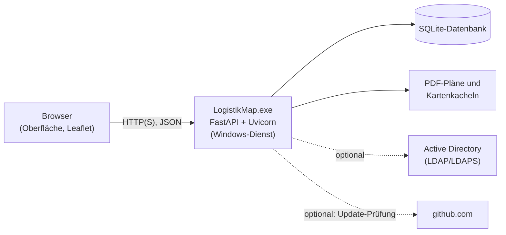

| Pfad | Inhalt |
|---|---|
| `logistikmap/server.py` | Webserver und JSON-Schnittstelle |
| `logistikmap/db.py` | SQLite-Datenbank mit Migrationen |
| `logistikmap/plaene.py` | PDF → Kartenkacheln (PyMuPDF) |
| `logistikmap/feiertage.py` | Feiertage je Bundesland |
| `logistikmap/regeln.py` | Wiederholungsregeln der Lieferungen |
| `logistikmap/netz.py` | Wegenetz und Wegsuche |
| `logistikmap/simulation.py` | Ablauf eines Tages mit Wartezeiten |
| `logistikmap/planung.py` | Schnittstellen für Netz, Stammdaten, Lieferungen, Szenarien, Simulation |
| `logistikmap/einrichtung.py` | Prüfung für die Seite „Erste Schritte“ |
| `logistikmap/standort.py` | Aktuelles Krankenhaus je Anfrage und Zugriff je Benutzer |
| `logistikmap/export.py` | Excel-Import/-Export, Karte als PDF |
| `logistikmap/wartung.py` | Sicherung, Wiederherstellung, Updates |
| `logistikmap/verzeichnis.py` | Anmeldung über Active Directory (LDAP) |
| `logistikmap/protokoll.py` | Änderungsprotokoll |
| `logistikmap/static/` | Oberfläche (ohne Build-Schritt, Leaflet liegt bei) |
| `logistikmap/static/i18n/` | Texte der Oberfläche je Sprache |
| `logistikmap/static/hilfe/` | Hilfe im Programm (Deutsch, Englisch) |
| `installer/` | Inno-Setup-Skript, Windows-Dienst (WinSW), Build-Skript |
| `werkzeuge/screenshots.py` | Musterklinikum aufbauen und die Bilder für diese Seite erzeugen |

### Weitere Sprache hinzufügen

Deutsch und Englisch sind enthalten. Für eine weitere Sprache:

1. `logistikmap/static/i18n/de.json` kopieren, z. B. nach `fr.json`, und übersetzen.
2. In `logistikmap/server.py` die Sprache in `SPRACHEN` eintragen.

`tests/test_oberflaeche.py` prüft, ob alle Schlüssel und Platzhalter vorhanden sind.

## Sicherheit

Sicherheitslücken bitte nicht als öffentliches Issue melden, sondern wie in
[SECURITY.md](SECURITY.md) beschrieben.

## Lizenz

[GNU Affero General Public License v3.0](LICENSE). Die Nutzung ist kostenlos, auch im Betrieb
eines Krankenhauses. Die Lizenzen aller mitgelieferten Bestandteile (u. a. PyMuPDF unter
AGPL-3.0, ldap3 unter LGPL-3.0, Leaflet, WinSW) stehen nach der Installation in
`THIRD_PARTY_LICENSES.txt` im Programmordner. Erzeugt wird die Datei beim Bauen mit
`installer/lizenzen.py`.
