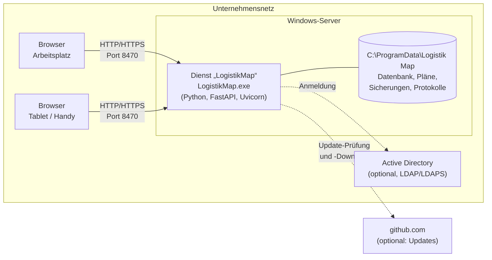

# Logistik Map – Technik und Betrieb

Diese Seite beschreibt den technischen Aufbau und den Betrieb im eigenen Netz:
Systemvoraussetzungen, Netzwerk, Daten, Sicherheit und Wartung. Alle Angaben beziehen sich auf die
[neueste Version](https://github.com/phillhf/logistik-map/releases/latest) und lassen sich im
Quellcode dieses Repositorys nachprüfen.

## Steckbrief

| | |
|---|---|
| **Zweck** | Planung und Simulation von Warenflüssen und Transportwegen in Krankenhäusern (Lieferungen, Aufzüge, Fahrzeuge) auf Basis der Gebäudepläne |
| **Art** | Webanwendung. Ein Windows-Dienst auf einem Server, Zugriff per Browser (Edge, Chrome, Firefox) aus dem eigenen Netz |
| **Hersteller / Pflege** | Open-Source-Projekt auf GitHub, [phillhf/logistik-map](https://github.com/phillhf/logistik-map) |
| **Lizenz** | GNU AGPL-3.0, kostenlos. Quellcode vollständig offen |
| **Installation** | Setup-Programm (Inno Setup), auch unbeaufsichtigt |
| **Daten** | Lokal auf dem Server: SQLite-Datenbank, PDF-Pläne, Sicherungen. **Keine Patientendaten** |
| **Internet** | Nicht erforderlich. Optional: Update-Prüfung bei github.com |
| **Telemetrie** | Keine |

## Aufbau



Der Server liefert die Oberfläche selbst aus. Der Browser lädt **keine** Inhalte aus dem
Internet (keine CDNs, keine Webfonts, keine Kartendienste). Die Kartenansicht sind die eigenen
PDF-Pläne, die der Server einmalig in Kacheln umwandelt.

## Systemvoraussetzungen

| | |
|---|---|
| **Betriebssystem** | Windows Server 2016 oder neuer, Windows 10/11 – jeweils 64 Bit |
| **Laufzeitumgebungen** | Keine zusätzlichen. Python und alle Bibliotheken sind im Programm enthalten |
| **Arbeitsspeicher** | Im Betrieb gemessen rund 110 MB. Beim Umwandeln großer PDF-Pläne kurzzeitig mehr. Empfehlung: 2 GB frei |
| **Festplatte** | Programm rund 150 MB. Daten je nach Plänen von wenigen hundert MB bis einige GB (Kartenkacheln großer CAD-Pläne) plus Sicherungen |
| **Clients** | Aktueller Browser. Keine Installation am Arbeitsplatz |

## Installation und Verteilung

1. Setup aus den [Releases](https://github.com/phillhf/logistik-map/releases/latest) herunterladen
   und die Prüfsumme kontrollieren (siehe [Herkunft und Integrität](#herkunft-und-integrität)).
2. Als Administrator ausführen, Port wählen, optional die Firewall-Regel anlegen lassen.
3. Im Browser das erste Administrator-Konto anlegen.

Unbeaufsichtigt, z. B. für die Softwareverteilung:

```
LogistikMap-Setup-x.y.z.exe /VERYSILENT /PORT=8470 /TASKS="firewall"
```

Was das Setup einrichtet:

| | |
|---|---|
| Programm | `C:\Program Files\Logistik Map` |
| Daten | `C:\ProgramData\Logistik Map` (bleibt bei Update und Deinstallation erhalten) |
| Dienst | `LogistikMap` („Logistik Map“), Start automatisch (verzögert), Neustart bei Absturz. Umsetzung mit [WinSW](https://github.com/winsw/winsw) |
| Firewall | nur auf Wunsch: eingehende Regel „Logistik Map“ für den gewählten TCP-Port |
| Startmenü | Verknüpfung zur Weboberfläche |

**Deinstallation** über „Apps & Features“. Dienst, Programm und Firewall-Regel werden entfernt. Der
Datenordner bleibt bestehen und kann bei Bedarf von Hand gelöscht werden.

## Netzwerk

| Richtung | Ziel | Port / Protokoll | Wofür | Pflicht? |
|---|---|---|---|---|
| eingehend | Server | TCP 8470 (einstellbar), HTTP oder HTTPS | Weboberfläche und Schnittstelle | ja |
| ausgehend | Domänencontroller | 389 (LDAP) bzw. 636 (LDAPS) | Anmeldung über Active Directory | nur wenn eingerichtet |
| ausgehend | `api.github.com`, `github.com` und die Download-Server von GitHub, HTTPS 443 | Update-Prüfung (wenn ein Administrator das Programm öffnet, höchstens alle 10 Minuten) und Download eines Updates auf Knopfdruck | nein |

- Ohne Internetzugang funktioniert alles. Die Update-Prüfung meldet dann nur „keine Verbindung“,
  Updates werden in dem Fall per Setup eingespielt.
- Der Dienst lauscht standardmäßig auf allen Netzwerkkarten. In
  `C:\ProgramData\Logistik Map\config.json` lässt sich mit `"host"` eine Adresse festlegen,
  zum Beispiel `"127.0.0.1"` hinter einem Reverse Proxy.
- **HTTPS:** Zertifikat und privaten Schlüssel (PEM, z. B. aus der eigenen PKI) unter
  *Einstellungen → HTTPS* eintragen. Bei HTTPS werden Sitzungs-Cookies nur verschlüsselt übertragen.

## Benutzer und Anmeldung

- **Lokale Konten:** Passwörter mit mindestens 8 Zeichen, gespeichert als scrypt-Hash mit Salz.
- **Active Directory:** Anmeldung per LDAP/LDAPS gegen die Domäne. AD-Gruppen werden Rollen
  zugeordnet, die Rolle wird bei jeder Anmeldung neu gesetzt. Kennwörter aus dem AD werden nicht
  gespeichert.
- **Rollen und Rechte:** Ansehen, Lieferungen & Szenarien, Gebäude/Karte/Stammdaten, Verwaltung;
  eigene Rollen möglich. Zusätzlich lässt sich je Benutzer festlegen, welche Krankenhäuser er
  sehen darf.
- **Sperre bei Fehlversuchen:** nach 5 falschen Passwörtern je Benutzername eine Minute, je
  Adresse erst nach 30 (damit Terminalserver und Citrix nicht alle aussperren).
- **Sitzungen:** Abmeldung nach 12 Stunden ohne Nutzung. AD-Benutzer müssen sich spätestens nach
  12 Stunden neu anmelden, ein gesperrtes AD-Konto verliert den Zugang also innerhalb einer Schicht.
  Beide Werte sind einstellbar. Das Sitzungs-Cookie ist `HttpOnly` und `SameSite=Strict`.
- **Notfall:** Ein vergessenes Admin-Passwort lässt sich nur am Server selbst zurücksetzen
  (`LogistikMap.exe passwort admin`, Eingabeaufforderung als Administrator).

## Daten und Datenschutz

| Daten | Inhalt | Personenbezug |
|---|---|---|
| Gebäude, Pläne, Strecken | PDF-Grundrisse, Räume, Wege, Aufzüge | nein |
| Lieferungen, Stammdaten, Szenarien | Uhrzeiten, Mengen, Lieferantennamen, Fahrzeuge | nein (Lieferanten sind Firmen) |
| Benutzerkonten | Benutzername, Anzeigename, Rolle, Sprache, Passwort-Hash | ja, Beschäftigte |
| Sitzungen | Zufallswert (nur als Hash gespeichert), Anlage- und letzte Nutzungszeit | ja |
| Änderungsprotokoll | Zeit, Benutzername, Aktion und betroffenes Objekt (z. B. „Lieferung Wäsche geändert“) | ja, Beschäftigte |
| Protokolldateien | technische Meldungen des Dienstes, z. B. Fehler und abgelehnte Anfragen | gering |

- **Keine Patientendaten.** Das Programm hat dafür auch keine Felder.
- Anmeldungen und IP-Adressen werden nicht ins Änderungsprotokoll geschrieben.
- Das Änderungsprotokoll wird standardmäßig **365 Tage** aufbewahrt, die Frist ist einstellbar
  (z. B. nach Absprache mit Datenschutz oder Personalrat). Ältere Einträge werden automatisch
  gelöscht.
- Alle Daten bleiben auf dem eigenen Server, es gibt **keine Telemetrie** und keine
  Cloud-Anbindung.

## Sicherheit im Überblick

- Quellcode offen und nachprüfbar, automatische Tests bei jeder Änderung
  ([Tests](https://github.com/phillhf/logistik-map/actions/workflows/tests.yml)).
- Rechte werden am Server geprüft, nicht nur in der Oberfläche. Auch der Zugriff je Krankenhaus
  gilt für jede einzelne Anfrage, direkte Links und Exporte eingeschlossen.
- Daten und Exporte gehen mit `Cache-Control: private, no-store` raus. Ein vorgeschalteter Proxy
  oder Zwischenspeicher legt sie deshalb nicht ab.
- Hochgeladene Dateien werden auf ein gültiges PDF geprüft und nur als Daten verarbeitet, nie
  ausgeführt.
- Updates werden nur installiert, wenn die SHA-256-Prüfsumme zum Release passt.
- Sicherheitslücken bitte vertraulich melden, siehe [SECURITY.md](../SECURITY.md).

## Dienstkonto und Updates

Der Dienst läuft als **LocalSystem**. Das ist für das Update auf Knopfdruck nötig. Dabei geht es so:

1. Ein Administrator klickt in *Einstellungen → Updates* auf „Update installieren“.
2. Der Dienst lädt Setup und Prüfsumme vom GitHub-Release und vergleicht die SHA-256-Prüfsumme.
3. Nur wenn sie passt, legt er eine einmalige geplante Aufgabe „LogistikMap Update“ an und
   startet sie. Sie führt das Setup unbeaufsichtigt als SYSTEM aus. Das Protokoll steht in
   `C:\ProgramData\Logistik Map\logs\update.log`.

Wer das nicht möchte, kann den Dienst in der Diensteverwaltung unter einem eigenen Konto laufen
lassen. Das Konto braucht Schreibrechte auf `C:\ProgramData\Logistik Map`. Updates werden dann
per Setup eingespielt. Daten und Einstellungen bleiben bei jedem Update erhalten.

## Sicherung und Wiederherstellung

- **Automatisch** in `C:\ProgramData\Logistik Map\sicherungen`: täglich die Datenbank, einmal pro
  Woche zusätzlich alle PDF-Pläne. Die Anzahl aufbewahrter Sicherungen ist einstellbar
  (Standard 14).
- **Von Hand** unter *Einstellungen → Sicherung*: vollständige Sicherung herunterladen oder eine
  Sicherung einspielen.
- **Für die Datensicherung des Servers** reicht es, `C:\ProgramData\Logistik Map` mitzusichern.

## Protokolle

| Datei | Inhalt | Begrenzung |
|---|---|---|
| `logs\logistikmap.log` | Meldungen der Anwendung | 5 MB je Datei, 5 Dateien |
| `logs\LogistikMap-Dienst.*.log` | Meldungen des Dienst-Rahmens (WinSW) | 10 MB je Datei, 5 Dateien |
| `logs\update.log` | Ablauf der Updates (Setup-Protokoll) | klein, entsteht nur bei Updates |

Alle unter `C:\ProgramData\Logistik Map\`.

## Herkunft und Integrität

- Jedes Release wird von **GitHub Actions aus dem getaggten Stand dieses Repositorys** gebaut
  ([Ablauf](https://github.com/phillhf/logistik-map/actions/workflows/release.yml)). Vor dem Bau
  laufen alle Tests.
- Zu jedem Setup gibt es eine Datei `.sha256` mit der Prüfsumme. Prüfen in PowerShell:

  ```powershell
  (Get-FileHash .\LogistikMap-Setup-x.y.z.exe -Algorithm SHA256).Hash
  Get-Content .\LogistikMap-Setup-x.y.z.exe.sha256
  ```

  Beide Werte müssen übereinstimmen (Groß-/Kleinschreibung spielt keine Rolle).
- Das Setup ist **nicht mit einem Code-Signing-Zertifikat signiert**. Windows SmartScreen kann
  deshalb beim ersten Start warnen. Die Echtheit lässt sich über die Prüfsumme kontrollieren;
  alternativ lässt sich das Setup mit einem eigenen Zertifikat signieren oder per Hash in AppLocker
  oder Intune zulassen.
- Mitgelieferte Bibliotheken und ihre Lizenzen stehen nach der Installation in
  `THIRD_PARTY_LICENSES.txt` im Programmordner. Der verwendete Dienst-Rahmen WinSW wird beim Bau
  nur mit fest hinterlegter Prüfsumme übernommen.

## Lizenz

Logistik Map steht unter der [GNU AGPL-3.0](../LICENSE). Die Nutzung, auch im Betrieb eines
Krankenhauses, ist kostenlos und ohne Registrierung. Pflichten entstehen erst, wenn man das
Programm **verändert** und die veränderte Fassung anderen zur Nutzung anbietet: Dann muss man
deren Quellcode ebenfalls bereitstellen. Für den unveränderten Einsatz ist nichts zu tun.

## Grenzen

- Eine Installation läuft auf **einem** Server mit einer SQLite-Datenbank. Ein Cluster oder eine
  externe Datenbank sind nicht vorgesehen.
- Die Ergebnisse sind eine **Planungshilfe**. Sie beruhen auf den eingegebenen Zeiten und Mengen
  und ersetzen keine Messung im Haus.
